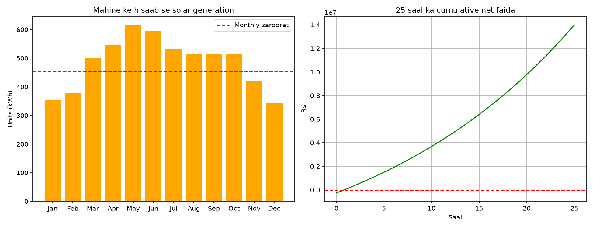

# Solar Panel Size & Savings Calculator

A Python project that estimates how many solar panels a home needs in Pakistan, what the system will cost, and how long it takes to earn the money back. It also draws graphs of monthly power generation and 25-year profit.

## What it does

- Asks for your city and monthly electricity bill
- Converts the bill into units (kWh)
- Calculates the system size (kW) and the number of panels
- Estimates the total cost (panels + inverter + installation)
- Shows monthly solar generation (higher in summer, lower in winter)
- Calculates the payback period and the 25-year net profit

## Screenshot

## How to run

1. Install Python 3.10 or newer
2. Install the library: `pip install matplotlib`
3. Run: `python main.py`

## Project structure

- `main.py`: user input, report and graphs
- `solar_calc.py`: all calculations and settings
- `data/bills.csv`: sample monthly bills

## Limitations

- All values are estimates, not a quotation. Prices change often.
- Power exported to the grid is paid at a lower rate than the full price, so the real payback is longer than shown.

## Tech

Python, matplotlib